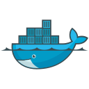

<h1 align="center">
  <a href="https://git.io/typing-svg">
    
  </a>
</h1>


<div align="center">
<!--p align="center">
  
</p-->
<a href="https://discord.gg/e5S8WZmE">

</a>
<a href="https://cyber.pz.it">

</a>
</div>

```python
class Pz:

    def __init__(self):
        self.username = 'cyber.pz'
        self.coding = {
            'started-in': '2013 as fullstack developer'
            'backend': ['Python', 'Java', 'PHP', 'NodeJS'],
            'frontend': ['HTML', 'CSS', 'JS', 'React', 'Boostrap', 'JQuery', 'Angular'],
            'database': ['MySQL', 'Oracle', 'MSSQL', 'SQLite', 'Mongo', 'Postgre', 'N4j'],
            'devops': ['Docker', 'Apache', 'Nginx', 'ReplIT', 'AWS', 'Heroku', 'Jenkins', 'Sterling B2B Integrator', 'SAG WebMethods'],
        }
        self.ai = {
            'started-in': '2018 at university with Computer Vision',
            'updated-in': '2026 the Agentic way, safely and locally adopting in-house Intelligence'
            'agents': ['Hermes Agent (maior.Domus)', 'openclaw', 'openHuman', 'custom-harnesses', 'Pi.dev'],
            'orchestration': ['multi-agent delegation', 'MCP', 'adversarial-review', 'loop prompting' ],
            'llm_serving': ['Halogen.cpp', 'llama.cpp', 'vLLM', 'Torch', 'Unsloth','LM Studio'],
            'favourite_models': ['Qwen3.8-Flash-Next', 'Qwen3.6-35b-a3b', 'GLM-5.1', 'Kimi K2.6'],
            'memory': ['Mem0','iii', 'Qdrant', 'pgvector', 'FTS5', 'AgentMemory', 'Honcho'],
            'voice': ['full-duplex pipeline', 'Chained pipe VAD→STT→LLM→TTS', 'live ASR', 'openWakeWord'],
            'browser': ['browser-use', 'remote browser bridge', 'Chrome MV3 automation'],
            'fine_tuning': ['Axolotl', 'Unsloth', 'TRL', 'LoRA/QLoRA'],
            'evals': ['golden-case evals', 'A/B benchmark tra modelli locali'],
            'vision': ['OpenCV', 'YoloNet', 'Stable Diffusion']
        }
        self.trading = ['Binance', 'Finandy', 'ByBit', 'PancakeSwap', 'MetaTrader 4/5', 'cTrader'] 
        self.gaming = ['BF6', 'COD Mobile','COD MW2 DMZ' 'COD BO ZM']
        self.music  = {
            'DAW': 'Ableton Live',
            'fav_genres': ['Hard Dance', 'Hard Bounce', 'Deep House', 'Tech House', 'Techno', 'Hard Rock', 'Rap', 'Piano', 'Jazz', 'Boogie Woogie']

    def __str__(self):
        return "Giuseeeeee!"


if __name__ == '__main__':
    me = Pz()
```
<h2 align="left"></h2>
<p href="https://github.com/cyberpz">

<h2 align="left">🤖 Active Projects</h2>

- **Hermes Agent fork** — [`cyberpz/hermes-agent`](https://github.com/cyberpz/hermes-agent)
  Fork del self-improving AI agent. Branch `cyberpz-patches`: dashboard plugins, Kanban multi-agent, patch locali su upstream NousResearch.
- **Domus** — Maggiordomo AI self-hosted
  Memoria semantica (Mem0 + Qdrant), inference locale su 2x GTX 980 Ti, voce TTS/STT, integrazione smart home (Shelly, Hue).
- **Cerberus** — Sorveglianza perimetrale
  12 camere CCTV via Dahua NVR API, heartbeat, zone-check, presence detection.
- **Telegram Operations** — Gateway conversazionale
  Hermes su Telegram (DM + supergruppi), cronjob, monitoraggio servizi, briefing automatici.


<h2 align="left">🧠 Agent Stack</h2>

Specializzazione: **agenti autonomi local-first** — inference, memoria e tool girano su hardware proprio, zero dipendenze cloud.

**Orchestrazione**
- Fork di [Hermes Agent](https://github.com/cyberpz/hermes-agent): subagent delegation, cron jobs, Kanban multi-agente, profili multi-identità
- **SegreterIA**: assistente amministrativo multi-tenant self-hosted (fatturazione, clienti, workflow N8N)
- MCP server + tool calling affidabile anche su modelli piccoli (2B–8B)

**Skills & Tools**
- **157 skill custom** in 21 categorie (repo `cyberpz-skills`): devops (31), creative (21), productivity (21), mlops (17), media (13), smart-home (7), social-media (8)…
- Browser automation: browser-use, remote browser bridge (guidare il browser dell'utente), estensioni Chrome MV3
- Automazione casa: flotta Shelly Gen1/2/3 via HTTP/MQTT+TLS, Sonos, Sonnen, NVR Dahua, rilevazione persone via CV

**Memoria & RAG**
- Stack memoria: Mem0 + Qdrant + FTS5 + AgentMemory
- RAG: pgvector + embedding Ollama, pipeline documentali su DB PostgreSQL

**Voce**
- Pipeline full-duplex: VAD → STT (Whisper) → LLM → TTS
- ASR live in tempo reale (domus-forger), Moshi, cloning con ElevenLabs

**Serving & Training**
- llama.cpp con speculative decoding e KV cache quantization per GGUF MoE su 24GB VRAM
- Fine-tuning QLoRA con Axolotl / Unsloth / TRL
- Evals: golden-case + benchmark A/B tra modelli locali prima di ogni deploy

**Integrazioni operative**
- Telegram: bot, canali, Telethon (azioni lato utente)
- Monitoring: Prometheus + Grafana, health-check automatici, runner notturni per benchmark


<h2 align="left" id="macropower-tech">Favorite Tech of the decade 2010 - 2020</h2>

<table align="center">
  <tr>
    <td align="center" width="96">
      <a href="#macropower-tech">
        
      </a>
      <br>Python
    </td>
    <td align="center" width="96">
      <a href="#macropower-tech">
        
      </a>
      <br>PHP
    </td>
    <td align="center" width="96">
      <a href="#macropower-tech">
        
      </a>
      <br>Jsonnet
    </td>
    <td align="center" width="96">
      <a href="#macropower-tech">
        
      </a>
      <br>JavaScript
    </td>
    <td align="center" width="96">
      <a href="#macropower-tech" >
        
      </a>
      <br>React
    </td>
    <td align="center" width="96">
      <a href="#macropower-tech">
        
      </a>
      <br>Bootstrap
    </td>
    <td align="center" width="96">
      <a href="#macropower-tech">
        
      </a>
      <br>Sass
    </td>
  </tr>
  <tr>
    <td align="center" width="96">
      <a href="#macropower-tech" >
        
      </a>
      <br>Docker
    </td>
    <td align="center" width="96">
      <a href="#macropower-tech" >
        
      </a>
      <br>Kubernetes
    </td>
    <td align="center"  width="96">
      <a href="#macropower-tech">
        
      </a>
      <br>Debian
    </td>
    <td align="center"  width="96">
      <a href="#macropower-tech">
        
      </a>
      <br>RHEL
    </td>
    <td align="center" width="96">
      <a href="#macropower-tech">
        
      </a>
      <br>Portainer
    </td>
    <td align="center"  width="96">
      <a href="#macropower-tech">
        
      </a>
      <br>MySQL
    </td>
    <td align="center" width="96">
      <a href="#macropower-tech" >
        
      </a>
      <br>Grafana
    </td>
  </tr>
 
 
</table>

<div style="display: flex;">
  <p style="flex: 1; align-items: center;">
    ⭐️ From <a href="https://github.com/cyberpz"> cyber.pz </a>
  </p>
  <p style="flex: 1; align-items: center;">
    
  </p>
</div>
